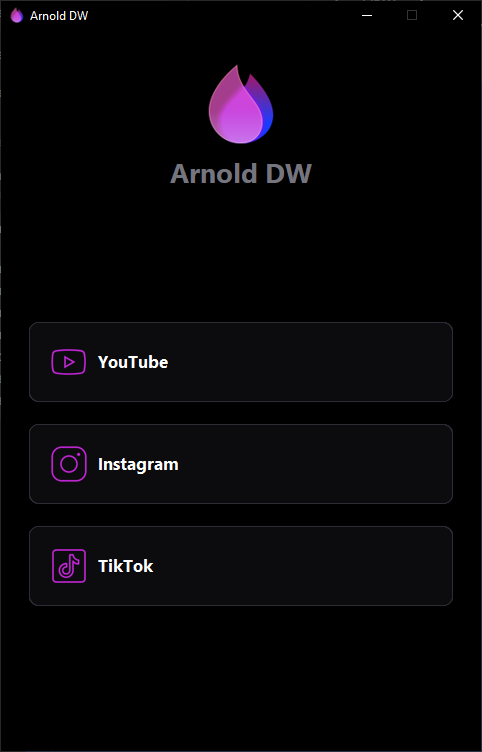

# Arnold DW


Arnold DW, YouTube ve Instagram içeriklerini Windows bilgisayarınıza indirmenizi sağlayan masaüstü uygulamasıdır. Bağlantıyı yapıştırın, önizlemeyi görün ve indirme seçeneklerini belirleyin.



## Çalışan özellikler

- **YouTube:** Tekil video için MP4 (kaynakta bulunan en yüksek çözünürlüğe kadar, 4K dahil) veya MP3 (320/192/128 kbps). Varsayılan MP4 her oynatıcıda açılan H.264 + AAC'dir.
- **Instagram:** Gönderi, reel ve carousel öğelerini önizleyip seçerek indirme. Herkese açık profillerde toplu indirme, isteğe bağlı "tarayıcı oturumumu kullan" seçeneğiyle.
- **İndirme kuyruğu:** Linki yapıştırıp "İndir"e basın; indirme arka planda sürer, siz sıradaki linki yapıştırırsınız. Aynı anda en fazla 2 indirme; ilerleme alttaki şeritte ve **İndirmeler** sekmesinde.
- **İndirmeler / geçmiş:** Aktif indirmeleri iptal etme; tamamlananları açma, klasörde gösterme, tekrar deneme. Geçmiş uygulama kapanıp açılınca korunur.
- **Önizleme:** Kapak, başlık, kanal ve süre bilgisi.
- **Ayarlar (⚙):** Kayıt klasörü, video modu, bilgi/kapak gömme, indirme motoru (yt-dlp) güncellemesi ve güncelleme kanalı, yardımcı araç durumu.

Arnold DW yalnızca YouTube ve Instagram'a odaklanır; diğer siteler uygulamada sunulmaz.

## Kurulum

Gereksinim: Windows 10 veya 11 (64 bit).

1. [GitHub Releases](https://github.com/arnoldgodsx/ArnoldDW/releases/latest) sayfasından `ArnoldDW-1.0.0-setup.exe` dosyasını indirin (her şeyi içeren tek dosya, yaklaşık 90 MB).
2. Çalıştırın. SmartScreen "Bilinmeyen yayıncı" uyarısı verirse (kurucu kod imzalı değildir) **Daha fazla bilgi → Yine de çalıştır**'ı seçin.
3. Sihirbazı izleyin: dil → kurulum kapsamı (tüm kullanıcılar / yalnızca ben) → kullanım koşulları → kurulum klasörü → isteğe bağlı masaüstü kısayolu → kur.

Yeni sürümü kurmak için kurucuyu yeniden çalıştırmanız yeterlidir; ayarlarınız ve geçmişiniz korunur.

## Kaldırma

**Ayarlar → Uygulamalar → Yüklü uygulamalar** içinde **Arnold DW → Kaldır**'ı veya Başlat menüsündeki **Arnold DW'yi kaldır** kısayolunu kullanın. Kaldırıcı açık uygulamayı kapatır ve `%APPDATA%\Arnold DW` içindeki ayar/geçmiş verilerinin silinip silinmeyeceğini sorar. İndirdiğiniz dosyalara dokunulmaz.

## Geliştirici kurulumu

Python kurulu bir Windows ortamında:

```powershell
git clone https://github.com/arnoldgodsx/ArnoldDW.git
cd ArnoldDW
python -m venv .venv
.venv\Scripts\Activate.ps1
pip install -r requirements.txt
python tools/fetch_binaries.py
python app.py
```

`fetch_binaries.py`, derleme için gerekli ikili dosyaları indirir. Uygulamayı paketlemek için PowerShell'de `tools/build.ps1` betiğini çalıştırın.

## Proje yapısı

Uygulama `arnold_dw/main.py` üzerinden başlar; çekirdek mantık `arnold_dw/core/`, ekranlar `arnold_dw/ui/`, testler `tests/`, belgeler `docs/`, tanıtım sitesi `site/` altındadır. Mimari, katkı tarifleri ve yayınlama ayrıntıları için [geliştirici rehberine](docs/gelistirici.md) bakın.

## Üçüncü taraf lisansları

Dağıtılan paketlerin lisans ve atıfları için [THIRD_PARTY_NOTICES.md](THIRD_PARTY_NOTICES.md) ile yanındaki `licenses/` tam metinlerine bakın.

## Kullanıcı belgeleri

- [Kullanım kılavuzu](docs/kullanim.md)
- [Sık sorulan sorular ve sorun giderme](docs/sss.md)
- [Yasal uyarı](DISCLAIMER.md)

## English

Read the [English README](README.md) for features, installation, developer setup, and project links.
